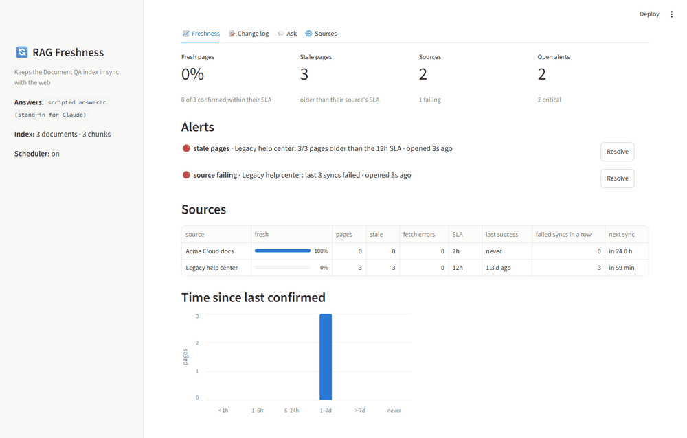
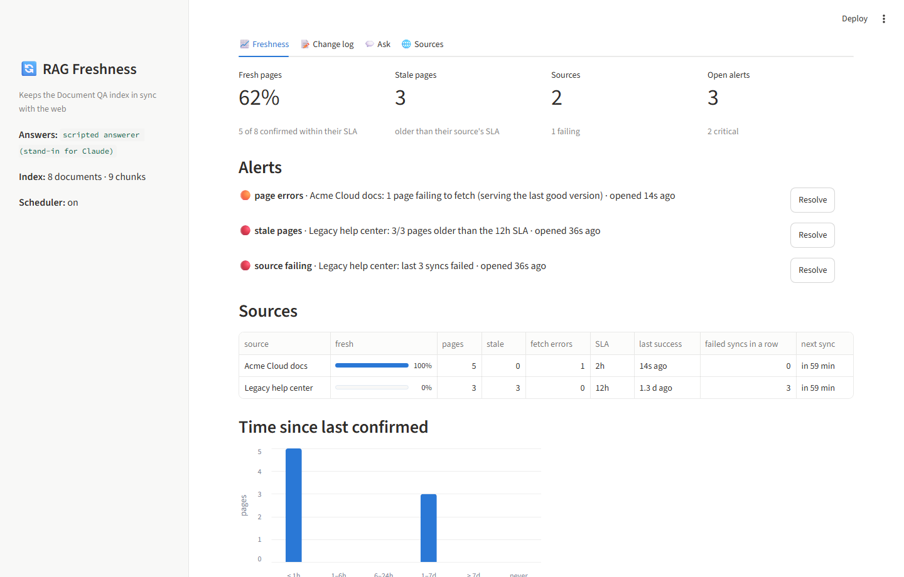
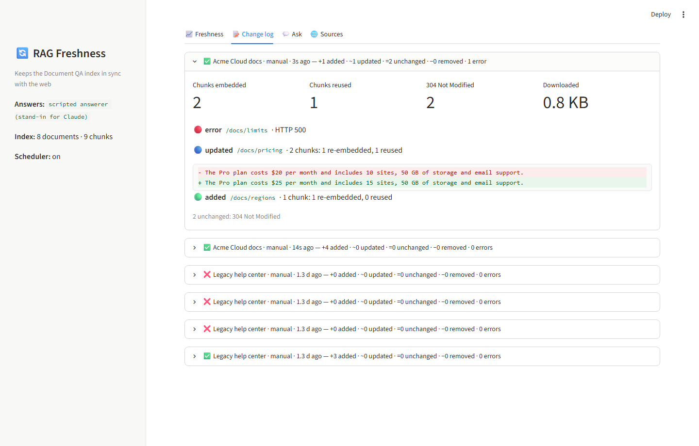
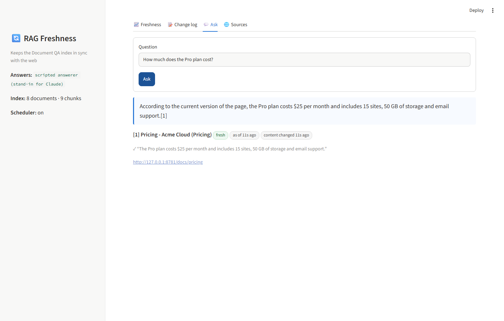
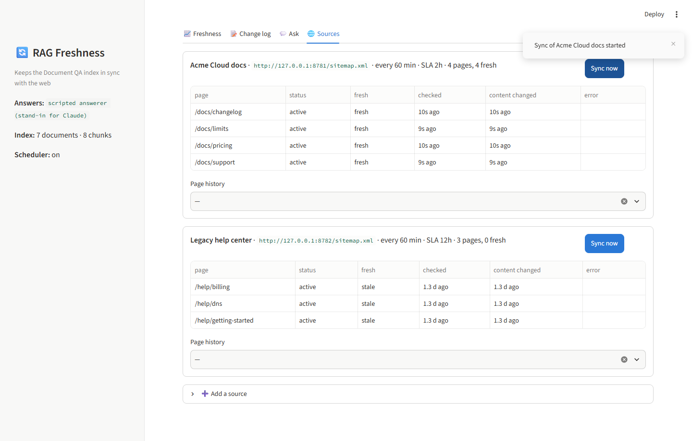
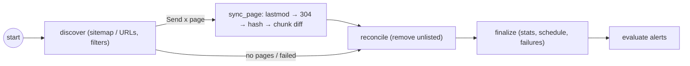

# RAG Freshness Pipeline

[](https://github.com/yordanossimegnew/rag-freshness-pipeline/actions/workflows/tests.yml)

Keeps a RAG index in sync with the web. Point it at a sitemap or a list of URLs and it
re-crawls on a schedule. It uses conditional requests so unchanged pages cost a `304`, and
**re-embeds only the chunks whose text actually changed**. Pages that disappear are removed.
Every change is logged with a line diff, and staleness is tracked against a per-source SLA,
with alerts. Answers show **"as of"** dates and warn when a source is stale.

The index it maintains is the one from
[Document QA with citations](https://github.com/yordanossimegnew/document-qa-citations). It reuses
that project's parser, chunker and pgvector store, so a refreshed page is indexed exactly as if
it had been uploaded there.

Built with **LangGraph** (a sync graph with a parallel per-page fan-out, and a time-aware QA graph)
and **LangChain** (`ChatAnthropic` with the Citations API, Voyage embeddings), on **PostgreSQL**
(pgvector), with a **FastAPI** API, a background scheduler and a **Streamlit** UI.



<sub>Demo uses scripted stand-ins for Claude and Voyage (named in the sidebar) and a local test website; the crawling, chunk diffing, PostgreSQL index, scheduling and alerts are real.</sub>

| Freshness | Change log | Time-aware answer | Sources |
|---|---|---|---|
|  |  |  |  |

## What a sync does

```
Acme Cloud docs · +1 added · ~1 updated · =2 unchanged · 1 error
  🔵 updated /docs/pricing · 2 chunks: 1 re-embedded, 1 reused
       - The Pro plan costs $20 per month and includes 10 sites ...
       + The Pro plan costs $25 per month and includes 15 sites ...
  🟢 added   /docs/regions
  🔴 error   /docs/limits · HTTP 500   (the last good version keeps being served)
  2 unchanged: 304 Not Modified
```

Asking *"How much does the Pro plan cost?"* right after that sync returns **$25**, cited, with
its page marked *fresh · as of 11s ago*.

## Features

- **Sources:** a `sitemap.xml` (sitemap indexes are followed) or a fixed list of URLs. Each source
  has include/exclude regexes, a page cap, a schedule in minutes, and a freshness SLA in hours.
  By default the SLA is two missed syncs.
- **Cheap, polite re-crawls:**
  - Unchanged `<lastmod>` entries in the sitemap are skipped without a request.
  - Every other page gets a conditional GET (`If-None-Match` / `If-Modified-Since`).
  - A `200` whose extracted text is unchanged (only the markup moved) is detected by a content
    hash and never re-embedded.
  - `robots.txt` is honoured and requests to the same host are spaced out.
  - Every URL, including each redirect hop, goes through Document QA's SSRF check.
- **Incremental, chunk-level index updates:**
  - A changed page is re-chunked with Document QA's own chunker.
  - Chunks whose text already exists **reuse their stored vector**; only new text is sent to
    Voyage.
  - The document keeps its id, and its chunks are swapped in **one transaction**, so readers never
    see half a page.
  - Pages that return `404`/`410` or leave the sitemap are deleted from the index.
- **Change log:** every sync records per-page events (added, updated, unchanged, removed, error,
  skipped) with a line diff and chunk, byte and embedding-cost stats. The last 20 text versions of
  each page are kept for history.
- **Staleness metrics and alerts:**
  - Each page's age is the time since it was last confirmed current.
  - Metrics: % of pages within SLA, an age histogram, and per-source failing streaks.
  - Alerts (deduplicated, auto-resolving, with an optional Slack-style webhook):
    - a **source failing** N syncs in a row;
    - **stale pages** past the SLA;
    - **pages failing to fetch**, which keep serving their last good version instead of
      disappearing.
- **Time-aware answers:**
  - Retrieval uses Document QA's hybrid search, with a small boost for recently changed pages.
  - Each cited document is labelled *"as of \<date\>"*, and the prompt tells Claude to trust the
    most recently changed source when sources disagree.
  - Answers drawn from stale pages are flagged.
- **Scheduler:** a background loop syncs due sources. Overlapping syncs of one source are refused
  (`409`). Syncs interrupted by a restart are marked failed and released on startup. Each sync
  runs as a LangGraph graph checkpointed in Postgres.

## Project structure

```
rag-freshness-pipeline/
├── README.md
├── requirements.txt
├── .env.example            # copy to .env (never commit .env)
├── .gitignore
├── Dockerfile
├── docker-compose.yml      # pgvector Postgres + API + UI (build from the parent folder)
├── main.py                 # FastAPI app (`main:app`) + CLI: serve / add-source / sync / status / ask
├── ui/app.py               # Streamlit: freshness, change log, ask, sources
├── docs/                   # demo.gif + screenshots
├── src/
│   ├── agent/
│   │   ├── sync.py         # LangGraph: discover -> Send x page -> reconcile -> finalize
│   │   ├── qa.py           # LangGraph: retrieve -> annotate freshness -> answer (citations)
│   │   ├── freshness.py    # page age vs SLA, metrics, alert rules, webhook
│   │   ├── scheduler.py    # background scheduler, no overlapping syncs
│   │   ├── factory.py      # wires Postgres, fetcher, index, Voyage, Claude
│   │   └── memory.py       # Postgres checkpointer
│   ├── tools/
│   │   ├── fetcher.py      # conditional GET, robots.txt, per-host delay, sitemap parsing
│   │   ├── index.py        # chunk-level diff into Document QA's pgvector index
│   │   ├── state.py        # Postgres: sources, pages, versions, runs, events, alerts
│   │   └── docqa.py        # imports Document QA's parser, chunker and store
│   ├── models/llm_client.py    # ChatAnthropic answerer, VoyageAIEmbeddings
│   ├── prompts/            # the time-aware answer prompt
│   ├── utils/              # config (env/.env), logging
│   └── api/routes.py       # FastAPI routes
└── tests/                  # a real local website (ETags, 304s, sitemap, robots) + Postgres
```

## Setup

Clone this repository **next to** `document-qa-citations` (or set `DOCQA_PATH`):

```bash
git clone https://github.com/yordanossimegnew/document-qa-citations
git clone https://github.com/yordanossimegnew/rag-freshness-pipeline
cd rag-freshness-pipeline
python -m venv .venv
# Windows: .venv\Scripts\activate   |   macOS/Linux: source .venv/bin/activate
pip install -r requirements.txt
cp .env.example .env              # ANTHROPIC_API_KEY, VOYAGE_API_KEY, database URLs
```

```sql
CREATE DATABASE rag_freshness;                 -- pipeline state
-- INDEX_DATABASE_URL points at Document QA's database (docqa); create it if you haven't
CREATE DATABASE rag_freshness_test;            -- pytest only
CREATE DATABASE rag_freshness_index_test;      -- pytest only
```

Run `CREATE EXTENSION vector;` in each index database.

## Use it

```bash
python main.py add-source "Acme docs" --sitemap https://docs.example.com/sitemap.xml --include "/docs/" --every 60
python main.py sync --all          # sync now (exit 1 if a sync failed)
python main.py status              # freshness report (exit 1 if anything is stale or failing)
python main.py ask "How much does the Pro plan cost?"
python main.py serve               # API + scheduler -> http://localhost:8000/docs
streamlit run ui/app.py            # UI -> http://localhost:8501
```

Document QA itself keeps working on the same database. Its `/ask` sees the refreshed pages
immediately.

## API

| Method | Path                      | Description                                                   |
|--------|---------------------------|---------------------------------------------------------------|
| POST   | `/sources`                | `{"name", "sitemap_url" \| "urls", "include", "schedule_minutes", "sla_hours"}` |
| GET    | `/sources`                | Sources with their freshness                                  |
| PATCH  | `/sources/{id}`           | Enable/disable, change schedule, SLA or filters               |
| DELETE | `/sources/{id}`           | Remove the source (and its pages from the index)              |
| POST   | `/sources/{id}/sync`      | Sync now (`409` if one is already running)                    |
| GET    | `/runs`, `/runs/{id}`     | Sync history; per-page events with diffs                      |
| GET    | `/pages`, `/pages/{id}`   | Pages with age/staleness; a page's version history            |
| GET    | `/metrics`                | % fresh, age histogram, per-source numbers                    |
| GET    | `/alerts`                 | Open alerts (`POST /alerts/{id}/resolve` to dismiss)           |
| POST   | `/ask`                    | Time-aware cited answer                                       |

## Tests

```bash
pytest -q
```

The tests serve a small website from a local HTTP server with real ETags, `304`s, a sitemap and
`robots.txt`, then mutate it between syncs. They use Postgres and Document QA's real index code,
and check that:
- unchanged pages cost a 304 and zero embeddings;
- a price change re-embeds exactly one chunk and keeps the document id;
- markup-only changes and unchanged sitemap `lastmod`s are skipped;
- unlisted and 404 pages are removed;
- fetch errors keep the old content;
- alerts open, deduplicate and resolve;
- the SSRF guard and overlapping-sync protection hold;
- answers cite the new price with its "as of" date and flag stale sources.

## How a sync works



## Ideas to extend

- More source types: RSS/Atom feeds, a GitHub `/docs` folder, a local folder.
- Claude-written change summaries ("price raised from $20 to $25") in the change log.
- Answer "as of" a past date from the stored page versions.
